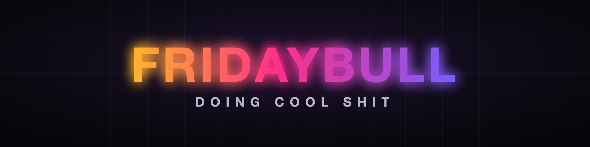

  

**Doing cool shit.** Building AI tools and products – and open-sourcing the tools.

### Open source

- **[nightshift](https://github.com/FridayBull/nightshift)** – AI agent teams that work while you sleep, locked down by default. Claude Code in a systemd + nftables + allowlist-proxy sandbox; results land as branches for you to review.
- **[cutai](https://github.com/FridayBull/cutai)** – an AI plans the edit, cutai builds it. Beat-synced video edits, open color grading and a live before/after view. Python + ffmpeg + Apple Vision.

More tools coming.
